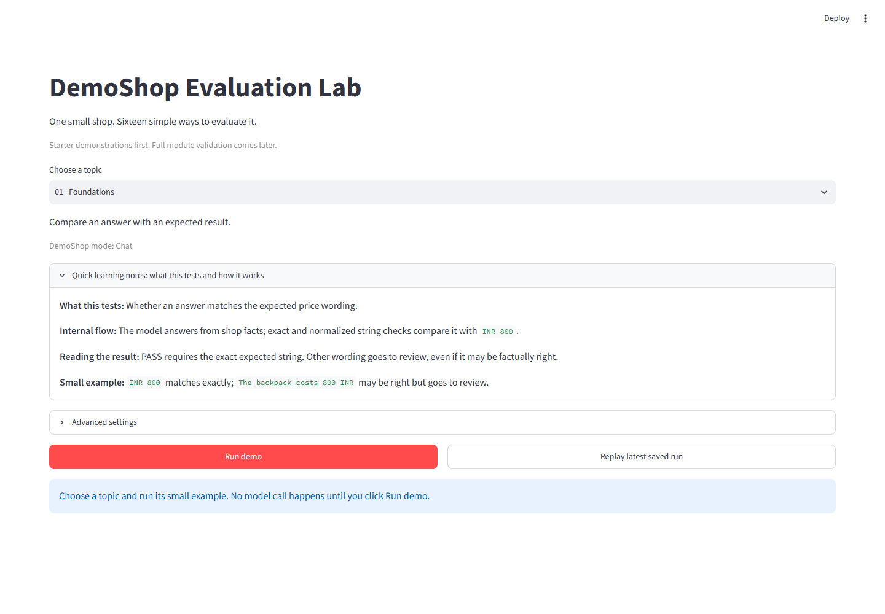

# AI Evaluation Lab

**A hands-on lab for learning how to evaluate AI applications and agents.**

**AI evaluations** are repeatable checks that measure how an AI system behaves
on specific tasks. They help us find problems that a fluent-sounding answer can
hide: wrong facts, unsupported claims, incorrect tool calls, or unsafe actions.
Running the same checks after a change also helps catch regressions.

DemoShop makes these ideas concrete through small browser demonstrations. Each
example follows a simple evaluation flow:

**Question or task → expected behavior → actual result → check → review**

For example, ask for a notebook's price, expect **INR 100**, then check the
answer against the shop's catalog. A different check might inspect whether an
order was actually cancelled.

- **Try a case:** run an example and compare what happened with what you expected.
- **Understand the result:** open the learning notes for a plain-language
  explanation and a small example.
- **Look inside:** inspect the code and traces behind the demonstration.



*Explore the Foundations demo and its learning notes before running a case.*

## What you will learn

| Evaluation area | Question you will explore | Topics |
|---|---|---|
| Answer quality | Is the answer correct, and who or what checks it? | Foundations, deterministic checks, human review, model judges |
| Model comparison | How do models perform on the same questions? | Benchmarking |
| Chat and RAG | Does the assistant remember context and use retrieved facts? | Conversation, retrieval and citations |
| Tools and skills | Did the assistant choose and use the right capability? | Tool calling, MCP, application skills |
| Agents | Did the task succeed, and how did the agents coordinate? | Single-agent and multi-agent workflows |
| Security and reliability | Are unauthorized actions blocked, and how much evidence supports a result? | Security, statistics |
| Operations and regression | What resources did a run use, and did a known check break? | Latency and token usage, regression checks |

Each topic is a small starter demonstration. Explore the full list and its
limitations in the [Intro guide](intro/README.md).

## Get started

**You will need:**

- Python 3.14 (the project currently requires Python 3.14.x).
- [uv](https://docs.astral.sh/uv/) to install and run the project.
- For live model examples, either an OpenRouter API key and a compatible model,
  or Ollama with a model already installed.

**Choose a starting point:**

- **No model or API key needed:** 09 MCP, 13 Security, 14 Statistical
  reliability, and 16 Regression / CI.
- **OpenRouter or Ollama needed:** 01 Foundations, 02 Deterministic, 03 Human
  evaluation, 04 LLM judges, 05 Model benchmarking, 06 Chat, 07 RAG,
  08 Tool calling, 10 Skills, 11 Single agent, 12 Multi-agent, and 15 Operations.
  Even when a check is deterministic or human-reviewed, its demo first asks a
  model to generate an answer.

Some demos require a model that supports structured output or tool calling.

From the repository root, install dependencies and start the lab:

```powershell
uv sync --locked --extra dev
uv run lab
```

Open http://127.0.0.1:8501 and choose a topic. To try an example without a model,
select **13 · Security** or **16 · Regression / CI**, then click **Run demo**.

To run model-based examples, choose one provider:

- **OpenRouter:** Open the project-root `.env` file and add your key as
  `OPENROUTER_API_KEY=your-key`. If `.env` is missing, create it with that line.
  Restart the lab if it is already running. Under **Advanced settings**, select
  OpenRouter and an available model ending in `:free`.
  Remove your key from `.env` before staging or committing the file.
- **Ollama:** Start Ollama with a model already installed. Under **Advanced
  settings**, select Ollama and enter its installed model tag. No model is
  downloaded automatically.

## Try these first

In the topic selector, follow this short path. For each example, open **Quick
learning notes**, predict the result, select **Run demo**, and compare what
happened with the stated check.

1. **02 · Deterministic:** Check a product price against the catalog. Notice how
   a rule can verify a fact and when unfamiliar wording needs review.
2. **03 · Human evaluation:** Read an answer and record your own assessment.
3. **04 · Judges:** See a model judge an answer. Compare its reason with your
   assessment; a judge can be wrong.
4. **07 · RAG:** See which policy was retrieved and whether the answer cites it.
   A citation alone does not prove that every claim is supported.
5. **11 · Single agent:** Follow the tool calls and check whether the sandbox
   order actually changed. Open **Inspect code, traces and saved evidence** to
   see the steps.

The shop and its orders are fictional. Results apply to the stated check; a
model judge can be wrong. See the [Intro guide](intro/README.md) for all topics,
result interpretation, and replay.

## Offline checks

```powershell
uv run --locked --offline pytest
uv run --locked --offline ruff check .
uv run --locked --offline ruff format --check .
uv run lab --check
uv run lab --check --broken
```

The last command intentionally fails to demonstrate a regression check.
